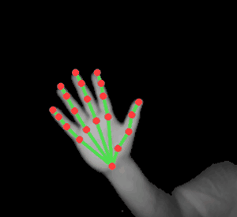
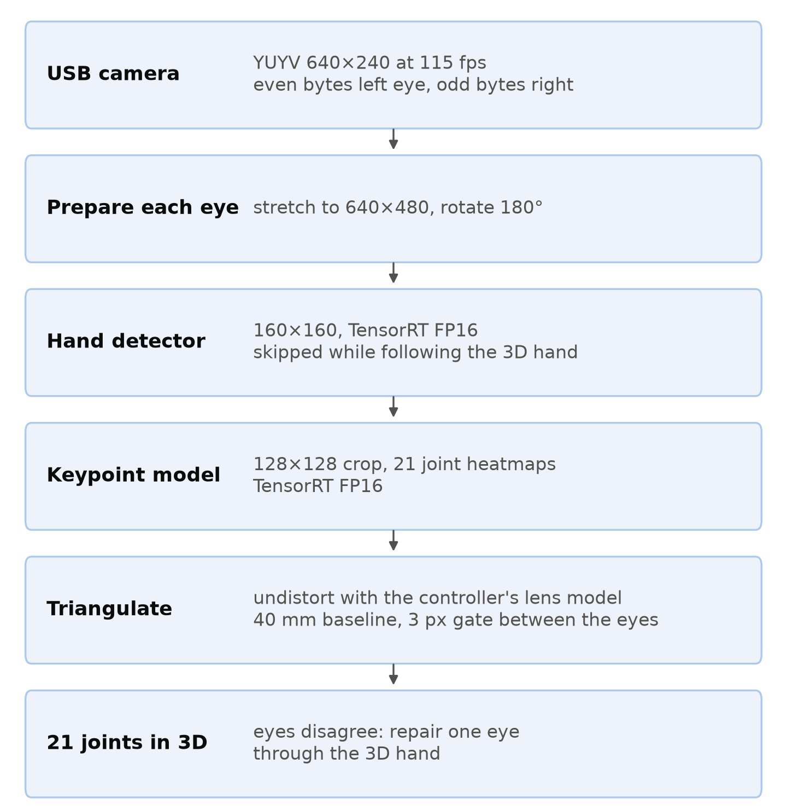
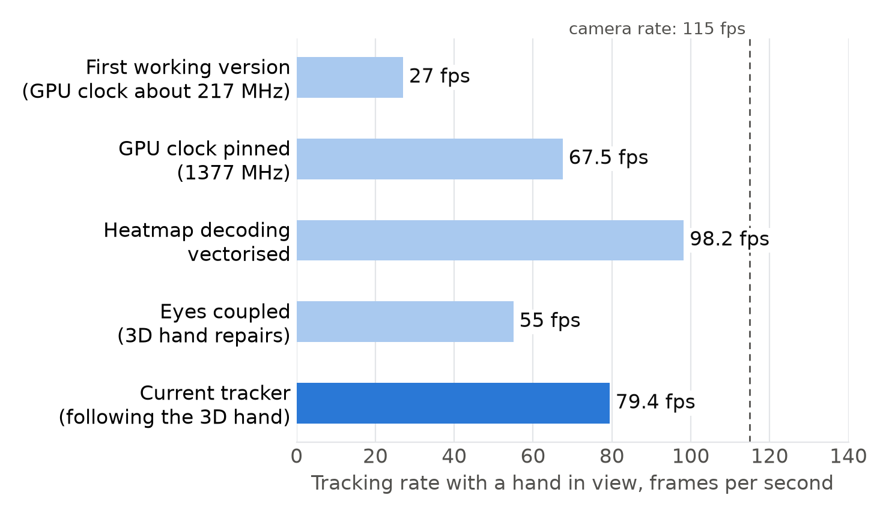

# Reviving the original Leap Motion on a Jetson GPU, without the vendor's software

*Angel Marquez Aguilar, 9 November 2026*

**Result.** 3D hand tracking from a 2013 Leap Motion Controller on an NVIDIA Jetson AGX Xavier, at
about 80 frames per second (fps) with a hand in view and 14.5 ms from camera frame to 3D joints.
It runs on the GPU, using open hand models from the Monado project, and needs no Ultraleap software. The
code is open source: [github.com/OomAngel/leap-jetson](https://github.com/OomAngel/leap-jetson).



This article explains how the tracker works, what each speed-up was worth, what failed along the way and
where the limits are. Every number states the hardware state it was measured in. You can also try the
tracker without owning the hardware, on a sample recording.

## The problem

The original Leap Motion Controller is two infrared cameras and three infrared lights in a small USB box.
Many of them sit unused in drawers. Ultraleap, the company behind it, never shipped hand tracking for this
controller on ARM Linux, and its download servers are gone. Its newer ARM build runs, but reports "No
compatible models" for this controller.

I wanted gesture input for an orchard-robot interface, and the robot's computer is a Jetson. So the question
was simple: can a Jetson GPU track a hand from this controller with no vendor software at all?

## The constraints

- **Board:** Jetson AGX Xavier, JetPack 5.1 (Linux for Tegra 35.6.5), TensorRT 8.5, Python 3.8 from the
  system.
- **Controller:** firmware 1.7.1, read only. The project never writes firmware.
- **No vendor code.** The controller is read as a standard USB camera. The hand models are downloaded by the
  user and never redistributed.

## How it works



**Capture.** Under Linux the controller is a plain USB video device: YUYV format, 640×240 pixels at 115 fps.
The even bytes of each frame are the left eye and the odd bytes are the right eye.

**Calibration.** The lens and stereo parameters are stored on the controller itself, in 156 bytes, and are
read with two standard USB video control requests. The Linux driver caches those controls, so the read goes
directly over libusb and detaches the driver for about a second.

**Preparing the image.** A controller lying face up sees hands upside down compared with the views the models
were trained on, and the sensor bins its rows 2:1. Stretching each eye back to 640×480 and rotating it by 180°
took the median detector score from 0.006 to 0.74. No model change was needed; the image only had to look like
what the model expects.

**Models.** A hand detector (160×160 input) finds the hand, and a keypoint model (128×128 crop) produces 21
joint heatmaps. Both are Monado's Mercury models, converted to 16-bit floating point (FP16) TensorRT engines
on the Jetson. Compared with the original 32-bit ONNX models, the joints moved by 0.04 pixels on average and
1.6 pixels at most.

**From 2D to 3D.** The 21 joints of each eye are undistorted with the controller's own lens model and
triangulated over the 40 mm baseline. Only the joints are undistorted, never whole images.

**Keeping the eyes together.** If each eye tracks alone, one can drift onto the forearm and stay there. Now,
when the eyes disagree, the more confident eye places the other eye's crop through the 3D hand and the keypoint
model runs again there. After a good frame, both crops simply follow the 3D hand and the detector is skipped.
Frames where the eyes still disagree by more than 3 pixels give no 3D result rather than a wrong one.

## Measurements



All live runs are 20 seconds on the AGX Xavier with a moving hand. The camera delivers 115 fps.

| Run | GPU clock | Tracking rate | Camera to 3D, median |
|---|---|---|---|
| First working version | governor, about 217 MHz | 27 fps | 41.0 ms |
| Clock pinned | 1377 MHz | 67.5 fps | 19.1 ms |
| Heatmap decoding vectorised | 1377 MHz | 98.2 fps | 14.2 ms |
| Eyes coupled | 1377 MHz | 55 fps | 19 ms |
| **Current: eyes coupled, following the 3D hand (three runs)** | **1377 MHz** | **76–82 fps** | **14.2–14.6 ms** |

**The GPU clock was worth 2.5×.** Jetson's frequency governor saw a short, bursty load and held the GPU at about
217 MHz, where one detector call took 3.5 ms. With the minimum frequency raised to 1377 MHz, the same call took
1.04 ms. This costs one line of configuration, and it applies to any bursty inference on a Jetson. Measure it
before you optimise anything else.

**Vectorising the decoder was worth another 1.45×.** A per-joint Python loop that read the heatmaps took half of
the frame time. The vectorised version returned exactly the same joints on 464 sets of heatmaps.

**Accuracy can cost speed, and then win most of it back.** Coupling the eyes rescued many frames but cost time, because
each repair is another keypoint call: the live rate fell to 55 fps. On a hard recording with the hand at the edges
of the view, frames with a 3D hand rose from 260 to 1,114 of 2,300. Following the 3D hand then removed most of the
detector calls. On the same recordings at the same clock, it cut the median time per frame by 18–46% and left the
bone lengths steadier: their spread on hand-only frames fell from 13.8% to 7.5%. Live, the rate came back to about 80
fps. That is below the 98 fps of the version that tracked each eye on its own, but that version gave a 3D hand on only
77% of its frames, with the eyes 2.56 pixels apart. The current one gives a 3D hand on 90–98%, with the eyes under 0.9
pixels apart. The hand's path differed between these runs, so this is not a controlled comparison.

**Quality.** In the three live runs, 90–98% of processed frames gave a 3D hand, the two eyes agreed to 0.76–0.85 pixels (median), and the index finger's bones measured 38–39, 24 and 21 mm. The wrist to middle knuckle measured 89–90 mm in two runs and 103 mm in the third, at the
same depth. I have not found out why yet, so I would not rely on one run's bone lengths.

**Testing the lens model instead of trusting it.** The stored lens function, applied at full strength, made things
worse. To find out why, I held a sheet of paper taped to a hardcover book over the controller: its edges are
straight, so after a correct undistortion they must be straight lines. On about 300 clean edges per eye, the best
exponent for the radial correction was 0.05–0.10 rather than 1.0, with residual errors of about 0.2 pixels against
0.32. The controller's images are already nearly rectilinear.

## What failed, and why

Before writing my own tracker, I tried to run Ultraleap's software on the Jetson.

- **Gemini 5.17.1 for ARM** runs, but has no model for this controller.
- **Hyperion 6.2.0 for x64, under the box64 emulator.** It first needed a 16-byte atomic operation that box64's
  `libatomic` wrapper did not provide ([box64 #4573](https://github.com/ptitSeb/box64/issues/4573)). After that, any
  TCP connection sent it into a loop that allocated about 200 MB per second until the kernel's out-of-memory killer
  stopped it. A series of experiments ruled out the client version and box64's recompiler. A system-call trace
  showed the accepting thread going silent straight after the connection.
- **V2 2.3.1 for x64, under box64.** A race in box64's `__cxa_atexit` corrupted the heap
  ([box64 #4574](https://github.com/ptitSeb/box64/issues/4574)). With a lock added, it tracks at 80–90 fps. That route
  remains in the repository as a fallback, for anyone who needs Ultraleap's own tracking.

These dead ends cost time, but they are also why the final design is simple: no emulator, no vendor service, only a
USB camera and two models.

## Limits

- **Distance.** With a 40 mm baseline, one pixel of stereo disagreement is 12 mm of depth at 25 cm and 23 mm at 35 cm.
  Depth noise makes bones look longer: the wrist to middle knuckle reads about 101 mm at 30–35 cm. Keep the hand
  20–30 cm above the controller if you need measurements.
- **One hand, no smoothing.** There is no 3D smoothing yet, and only one hand is tracked. Fists and heavily occluded
  poses are the weakest.
- **No ground truth.** I checked bones, stereo agreement and straight edges, but did not compare against an external
  tracking system.
- **Tested on one board.** Only the AGX Xavier and firmware 1.7.1. Orin is untested.
- **Model licence.** The Monado model repository has no licence file. I asked the maintainers
  ([issue #1](https://gitlab.freedesktop.org/monado/utilities/hand-tracking-models/-/work_items/1)) and have no answer
  yet, so the project downloads nothing for you, redistributes nothing, and says so in its README.

## Try it yourself

**Without the hardware.** On any PC, using a 4-second, hand-only recording from the
[v0.1.0 release](https://github.com/OomAngel/leap-jetson/releases/tag/v0.1.0). I ran these steps from a fresh clone
on a desktop CPU: all 460 frames gave a 3D hand, at 43 fps.

```bash
git clone https://github.com/OomAngel/leap-jetson.git && cd leap-jetson
pip install onnxruntime opencv-python-headless numpy
git clone https://gitlab.freedesktop.org/monado/utilities/hand-tracking-models.git
git -C hand-tracking-models checkout 37a8a81
(cd hand-tracking-models && sha256sum -c ../models.sha256)
curl -LO https://github.com/OomAngel/leap-jetson/releases/download/v0.1.0/leap-jetson-sample-v1.zip
unzip leap-jetson-sample-v1.zip
python3 tracker/live_track.py --backend ort --replay leap-jetson-sample/sample_640x240.raw --every-frame \
    --calib leap-jetson-sample/calibration.bin --models hand-tracking-models --out frames.jsonl
```

**With the hardware.** A Leap Motion Controller on firmware 1.7.1 and a Jetson with JetPack 5: the
[README](https://github.com/OomAngel/leap-jetson#quick-start) has the quick start.

## How to cite it, and the licence

Marquez Aguilar, A. (2026). *leap-jetson: original Leap Motion Controller hand tracking on NVIDIA Jetson GPUs*
[Computer software]. Zenodo. <https://doi.org/10.5281/zenodo.24050502>

```bibtex
@software{marquez_aguilar_leap_jetson_2026,
  author    = {Marquez Aguilar, Angel},
  title     = {leap-jetson: original Leap Motion Controller hand tracking on NVIDIA Jetson GPUs},
  year      = {2026},
  publisher = {Zenodo},
  doi       = {10.5281/zenodo.24050502},
  url       = {https://github.com/OomAngel/leap-jetson},
  license   = {Apache-2.0}
}
```

**Licence.** The code and the sample recording are under the
[Apache License 2.0](https://github.com/OomAngel/leap-jetson/blob/main/LICENSE). The hand models are not part of the
project: you download them yourself, and their licence is unconfirmed (see Limits). Details are in
[LEGAL.md](https://github.com/OomAngel/leap-jetson/blob/main/docs/LEGAL.md) and
[THIRD_PARTY_NOTICES.md](https://github.com/OomAngel/leap-jetson/blob/main/THIRD_PARTY_NOTICES.md).

## How it was built

I built this with AI coding agents as part of my normal way of working. I chose the approach, ran every measurement
on the hardware, and own all of the code. The box64 issues are in my own words, as that project's policy asks.

*Not affiliated with, endorsed by or supported by Ultraleap. Leap Motion is a trademark of its owner.*
